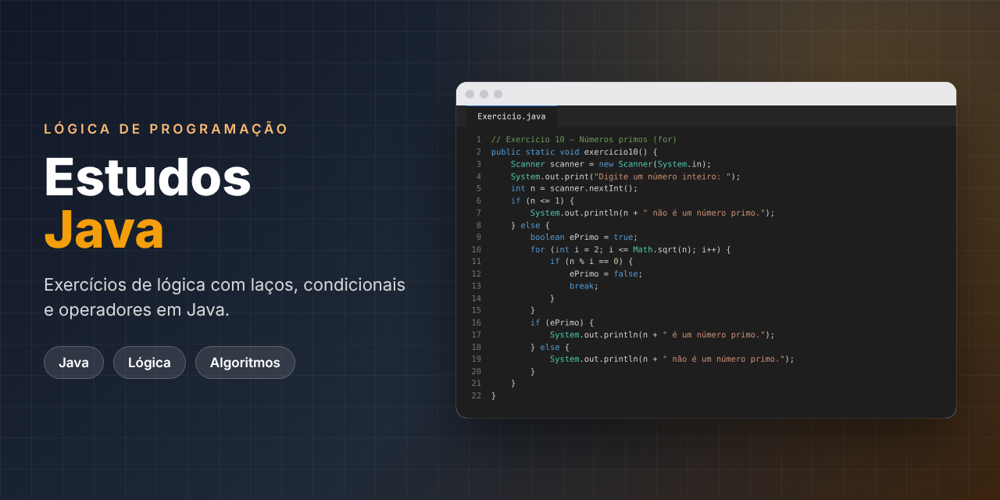
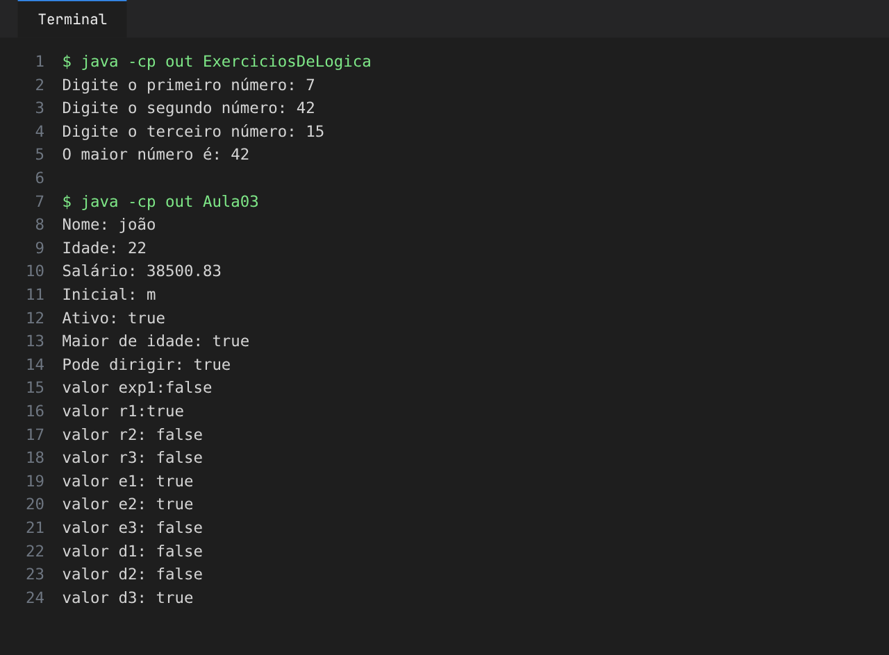

<p align="center">
  
</p>

<h1 align="center">☕ Estudos Java</h1>

<p align="center">
  Repositório dedicado ao meu aprendizado e evolução na linguagem <b>Java</b>: códigos de estudo, exercícios de
  lógica e anotações.
</p>

<p align="center">
  
  
  
</p>

<p align="center">
  <a href="#-sobre-o-projeto">Sobre</a> •
  <a href="#-exercícios">Exercícios</a> •
  <a href="#-telas">Saída</a> •
  <a href="#-como-executar">Como executar</a> •
  <a href="#-estrutura-do-projeto">Estrutura</a>
</p>

---

## 📌 Sobre o projeto

Aqui ficam os exercícios que faço para praticar os fundamentos do Java: variáveis e tipos primitivos, operadores
aritméticos, relacionais e lógicos, estruturas condicionais e laços de repetição (`for`, `while` e `do-while`), além
de algoritmos básicos como verificação de números primos, fatorial e tabuada.

## ✨ Exercícios

| | Arquivo | O que pratica |
|---|---|---|
| 🧮 | [`Aula03.java`](src/Aula03.java) | Variáveis, operadores de atribuição (`+=`, `*=`) e a precedência de expressões lógicas com `&&`, `\|\|` e `!` |
| 🔝 | [`ExerciciosDeLogica.java`](src/ExerciciosDeLogica.java) | Lê três números com `Scanner` e mostra o maior deles |
| 🔁 | [`Exercicio.java`](src/Exercicio.java) | Dez exercícios de laços, um por método (lista abaixo) |

Os dez métodos de `Exercicio.java`:

| Nº | Exercício | Laço |
|---|---|---|
| 1 | Contagem de 1 até N | `while` |
| 2 | Soma dos números digitados até o zero | `while` |
| 3 | Tabuada, repetindo enquanto o usuário quiser | `do-while` |
| 4 | Jogo de adivinhação de 1 a 100 | `do-while` |
| 5 | Fatorial | `while` |
| 6 | Contagem regressiva até "Fogo!" | `for` |
| 7 | Números pares de 1 a 50 | `for` |
| 8 | Soma dos múltiplos de 3 | `for` |
| 9 | Média das notas da turma | `for` |
| 10 | Verificação de número primo | `for` |

## 🖼️ Telas

Saída real dos programas no terminal:

<p align="center">
  
</p>

## 🚀 Como executar

**Pré-requisito:** um JDK instalado (testado com o JDK 21). Não há dependências externas.

```bash
git clone https://github.com/kauaxp77/estudos-java.git
cd estudos-java
javac -d out src/*.java

java -cp out Aula03
java -cp out ExerciciosDeLogica
java -cp out Exercicio
```

> 💡 O `main` de `Exercicio.java` está com as chamadas comentadas. Para testar um exercício, tire o `//` da linha
> correspondente (por exemplo, `exercicio10();`), compile e rode de novo.

## 📁 Estrutura do projeto

```
estudos-java/
├── src/
│   ├── Aula03.java              # Variáveis, operadores e expressões lógicas
│   ├── ExerciciosDeLogica.java  # Maior de três números
│   └── Exercicio.java           # 10 exercícios de laços de repetição
└── docs/
    ├── banner.png
    └── screenshots/
```

## 🛠️ Tecnologias

- **Java** (somente a biblioteca padrão: `Scanner`, `Random` e `Math`)

## 👨‍💻 Autor

Desenvolvido por **[kauaxp77](https://github.com/kauaxp77)**

<p align="center">⭐ Se curtiu o projeto, deixe uma estrela!</p>
